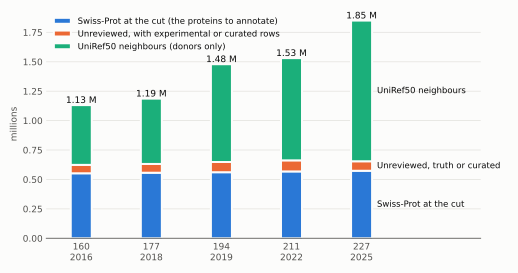
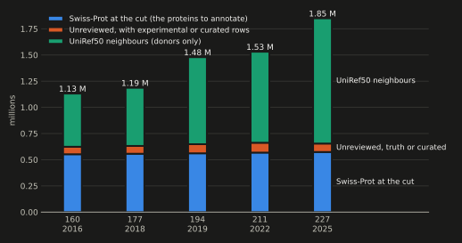
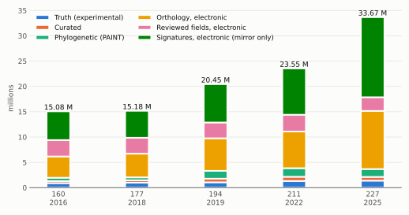
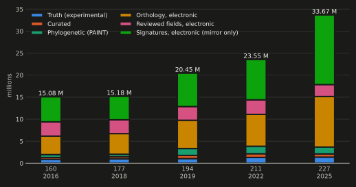

The corpus at a cut
===================

A *cut* is a date. Everything PROTEA learns or evaluates at a cut is built from
sources published on or before it, and the corpus of the cut is fixed as a
*photo*: a declared set of proteins with every Gene Ontology annotation (GOA)
row they carried at that date. The decision and its reasons are in
:doc:`adr/D59-the-corpus-at-a-cut-is-a-photo`; this page shows what the photos
hold.

Who is in a photo
-----------------

A protein enters a photo through one of four doors, all dated on or before the
cut:

- **Swiss-Prot at the cut.** The reviewed entries of the last UniProt release
  published on or before the cut. This is the set the cut is asked to annotate,
  and the only set that can hold an evaluation target.
- **Truth.** A protein with an experimental annotation (one of the thirteen
  evidence codes the LAFA benchmark accepts as a measurement).
- **Curated.** A protein with a curator's inference, such as a judgement of
  sequence similarity or orthology (the curated tier of
  :doc:`adr/D49-corpus-is-four-tiers-of-the-gaf-series`).
- **UniRef50 neighbours.** An unreviewed protein that shares a UniRef50 cluster
  with a Swiss-Prot protein and carries at least one phylogenetic (PAINT) or
  electronic orthology annotation. A neighbour is a donor of evidence only: it
  is never a target and never gives a label.

         of each photo into Swiss-Prot at the cut, unreviewed proteins with
         experimental or curated rows, and UniRef50 neighbours.

   Proteins in each full photo. Swiss-Prot grows slowly (0.55 to 0.57
   million); the photo grows with the annotated UniRef50 neighbours, which give
   the retrieval arms donors close to the proteins being annotated.

         of each photo into Swiss-Prot at the cut, unreviewed proteins with
         experimental or curated rows, and UniRef50 neighbours.

   Proteins in each full photo. Swiss-Prot grows slowly (0.55 to 0.57
   million); the photo grows with the annotated UniRef50 neighbours, which give
   the retrieval arms donors close to the proteins being annotated.

The first three rows of the table are classes: *Swiss-Prot at the cut* and
*Outside Swiss-Prot* split the members in two. The last three rows are
admission reasons, not classes. A member can meet several of them: a Swiss-Prot
protein with an experimental row is counted under Swiss-Prot and under truth.
Adding them up therefore gives a number that counts some proteins twice. The
unreviewed proteins with truth or curated rows, the middle part of the figure,
are *Outside Swiss-Prot* minus the neighbours. Cut 205 only
ends a window (177->205), so its photo is a truth-only photo: it holds what that
window's truth needs, carries no neighbours, and is left out of the figures.

.. csv-table:: Members of each photo, by cut (year)
   :file: _data/corpus-members.csv
   :header-rows: 1
   :stub-columns: 1

What a photo says about each protein
------------------------------------

Every GOA row of a member is kept, and each row is classed by its *evidence
channel*, a pure function of its evidence code, its reference, who assigned it
and whether the protein is reviewed at the cut.

A photo counts every line of the GOA file that belongs to a member, as the file
gives it. The annotation store keeps one row per protein, term, evidence code,
qualifier and reference, so lines that differ only in other columns (the
*with or from* column, who assigned it, the date) become one row there. The
store therefore holds about 3 to 5 % fewer rows than the photo counts. Those are
the same annotations, stored once. Which channels a method may read
is decided when it reads, not when the photo is built, so changing that
decision changes a filter, not the data.

         evidence channel: truth, curated, phylogenetic, orthology electronic,
         reviewed fields electronic, and signatures electronic.

   GOA rows in each full photo, by evidence channel. The largest channel,
   electronic annotation from signatures and family models, is stored as a
   mirror and never read by the recipe. Rows without data (``ND``, under 0.3 %
   of every photo) are in the table, not in the figure.

         evidence channel: truth, curated, phylogenetic, orthology electronic,
         reviewed fields electronic, and signatures electronic.

   GOA rows in each full photo, by evidence channel. The largest channel,
   electronic annotation from signatures and family models, is stored as a
   mirror and never read by the recipe. Rows without data (``ND``, under 0.3 %
   of every photo) are in the table, not in the figure.

.. csv-table:: GOA rows of each photo by evidence channel, by cut (year)
   :file: _data/corpus-rows.csv
   :header-rows: 1
   :stub-columns: 1

Where these numbers come from
-----------------------------

Nothing on this page is typed by hand. ``scripts/docs/corpus_figures.py`` reads
the manifest of each photo and writes the tables, the figures and
``docs/source/_data/corpus-by-cut.json``, which keeps every count beside the
full sha256 digest of the manifest it came from. Running it again on the same
manifests writes the same bytes.

Two columns of the table below license the figures above. Every photo classed its
rows with the same channel table, so a channel means the same thing at every cut
and a series over cuts compares like with like. And no row fell outside the
table: the seven channels are the whole of each photo, with nothing swept into
a residual class.

.. csv-table:: The photo manifests
   :file: _data/corpus-manifests.csv
   :header-rows: 1
