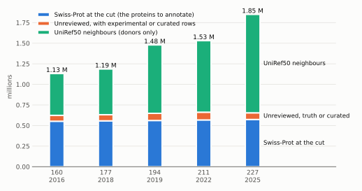
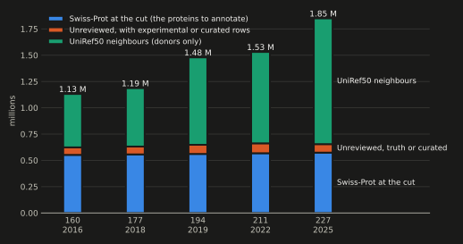

PROTEA
======

**PROtein functional Embedding-based Annotation**

PROTEA reads a protein's sequence and proposes its Gene Ontology terms, with
the evidence for each one in plain view. It is two things at once: an
*instrument*, a platform that keeps the corpus of every cut, runs the methods
and evaluates them under one set of rules; and a *research line* that uses the
instrument to ask how protein function is best predicted, and answers in a way
anyone can check.

.. raw:: html

   

Latest news
-----------

.. news-feed::
   :limit: 3

Every announcement, and where the project stands today, are on
:doc:`news`.

.. raw:: html

   

Start here
----------

.. grid:: 1 2 2 2
   :gutter: 3
   :margin: 2 0 2 0

   .. grid-item-card:: The research line
      :link: research_line
      :link-type: doc
      :shadow: md
      :text-align: left

      :bdg-primary:`Exploration` One line by stages: representations, sources
      of candidates, signals, a world model against decision trees, stratified
      evaluation and routing per stratum.

   .. grid-item-card:: The corpus at a cut
      :link: corpus
      :link-type: doc
      :shadow: md
      :text-align: left

      :bdg-info:`Data` What each cut holds, from 2016 to 2025: Swiss-Prot,
      experimental and curated annotation, UniRef50 neighbours, and every GOA
      row by evidence channel.

   .. grid-item-card:: News and status
      :link: news
      :link-type: doc
      :shadow: md
      :text-align: left

      :bdg-success:`Status` Dated announcements, the current champion with the
      number it was measured at, and the next milestones.

   .. grid-item-card:: Quickstart
      :link: appendix/installation_and_quickstart
      :link-type: doc
      :shadow: md
      :text-align: left

      :bdg-primary:`Run it` Bring up the full stack from a fresh checkout and
      run your first job in about ten minutes.

   .. grid-item-card:: Architecture
      :link: architecture/index
      :link-type: doc
      :shadow: md
      :text-align: left

      :bdg-info:`Design` System layers, job lifecycle, data model, the full
      operation catalogue, the evaluation protocol, and the decision records
      that explain *why*.

   .. grid-item-card:: Results
      :link: results
      :link-type: doc
      :shadow: md
      :text-align: left

      :bdg-danger:`Evidence` The sealed board of July 2026 on the earlier
      temporal frame, with its metric, scoring recipe and reproduction path.

   .. grid-item-card:: API Reference
      :link: reference/index
      :link-type: doc
      :shadow: md
      :text-align: left

      :bdg-secondary:`autodoc` Symbol-level documentation for ``protea.core``,
      ``protea.infrastructure``, the FastAPI routers, and every worker class.

   .. grid-item-card:: Complexity
      :link: complexity/index
      :link-type: doc
      :shadow: md
      :text-align: left

      :bdg-warning:`Performance` Big-O profile per pipeline stage, measured
      hot paths, and a guide to profiling.

.. raw:: html

   

         of each photo into Swiss-Prot at the cut, unreviewed proteins with
         experimental or curated rows, and UniRef50 neighbours.

   The corpus of each cut, from 1.13 million proteins in 2016 to 1.85 million
   in 2025. Swiss-Prot is the set to annotate; the rest is evidence. More in
   :doc:`corpus`.

         of each photo into Swiss-Prot at the cut, unreviewed proteins with
         experimental or curated rows, and UniRef50 neighbours.

   The corpus of each cut, from 1.13 million proteins in 2016 to 1.85 million
   in 2025. Swiss-Prot is the set to annotate; the rest is evidence. More in
   :doc:`corpus`.

.. admonition:: What is PROTEA?
   :class: tip

   A platform for protein functional annotation, built in the open. It takes
   the corpus of each cut (Swiss-Prot, experimental and curated annotation,
   annotated UniRef50 neighbours), computes embeddings with eight protein
   language models, gathers candidate terms from several sources (what the
   protein already says, transfer from neighbours, association between
   terms), learns at each cut how to weigh them, and evaluates every method
   under the LAFA benchmark's rules, stratum by stratum. It consolidates the
   `Protein Information System <https://github.com/CBBIO/protein-information-system>`_
   and `FANTASIA <https://github.com/CBBIO/FANTASIA>`_ codebases into one
   decoupled architecture.

   New here? Read :doc:`overview`, then :doc:`research_line`.

.. toctree::
   :caption: Documentation
   :maxdepth: 2

   overview
   research_line
   corpus
   news
   abstract
   introduction
   related_work
   architecture/index
   complexity/index
   guides/plugin-authoring/index
   results
   ablation
   operate/reproduce-the-sealed-board
   operate/join-a-compute-node
   appendix/index
   runbooks/index
   quality/index
   insights
   glossary
   references

.. toctree::
   :caption: API Reference
   :maxdepth: 2
   :hidden:

   reference/index

.. toctree::
   :caption: Historical (superseded)
   :maxdepth: 1
   :hidden:

   historical/index
